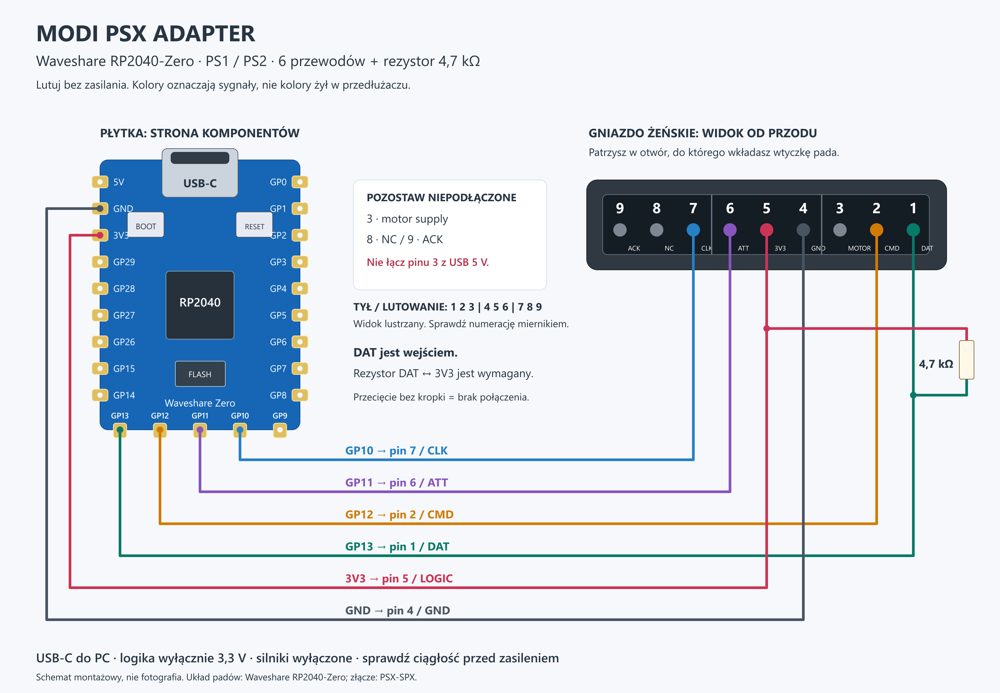

# Modi PSX Adapter — wykonanie i uruchomienie

Potrzebujesz płytki **RP2040-Zero** (nie LP2030), kabla USB z transmisją danych, przewodów, gniazda pada PS1/PS2 oraz rezystora **4,7 kΩ**.

Gniazdo możesz odzyskać z konsoli PS2. Nie trzeba kupować gotowego adaptera USB. Zespół gniazd lub taśma z konsoli nie musi mieć takiego samego układu wyprowadzeń jak samo złącze: przy odłączonym zasilaniu sprawdź ciągłość między stykami a punktami lutowania. Widok od przodu i od strony lutowania jest lustrzany.

| Pin złącza PSX | Sygnał | RP2040-Zero |
|---|---|---|
| 1 | DAT | GP13 i rezystor do 3V3 |
| 2 | CMD | GP12 |
| 3 | Zasilanie silników | Nie podłączaj w tej wersji |
| 4 | GND | GND |
| 5 | Zasilanie logiki | 3V3 |
| 6 | ATT / SELECT | GP11 |
| 7 | CLK | GP10 |
| 8 | NC | Nie podłączaj |
| 9 | ACK | Nie podłączaj w tym projekcie |

Rezystor 4,7 kΩ podciąga DAT do **3,3 V**. Możesz użyć kilku rezystorów zamiast jednego, jeżeli ich rezystancja zastępcza jest zbliżona do 4,7 kΩ, np. szeregowo 2,2 kΩ + 2,2 kΩ + 330 Ω = 4,73 kΩ. Zmierz wynik przed montażem. Nie łącz ich dowolnie i nie zastępuj rezystora zwarciem. Nie podawaj 5 V na GPIO ani zasilanie logiki PSX.

## Firmware

1. Pobierz [UF2 2.1](../firmware/modi_psx_adapter_rp2040zero.uf2).
2. Przytrzymaj BOOT / BOOTSEL płytki podczas podłączania USB.
3. Skopiuj UF2 na dysk RPI-RP2. Płytka uruchomi się ponownie jako **Modi PSX Adapter**.
4. Otwórz [tester RAW](https://modyfikatorcasper.github.io/psx-adaptive-calibration/tester/) w Chrome lub Edge na komputerze i wybierz adapter.

To firmware użyty w pomiarach, z poprawką przycisku ANALOG. W trybie cyfrowym znikają osie, a przyciski nadal działają; ponowne przełączenie przywraca analogi. Źródła i licencje znajdują się w [firmware](../firmware/README.md).

Firmware używa testowego VID/PID 1209:0001, który nie jest unikalnym identyfikatorem Sony ani przydzielonym identyfikatorem tego produktu. To obraz do prywatnych prób laboratoryjnych. Do dystrybucji gotowych urządzeń potrzebny jest uprawniony VID/PID; instrukcja budowania umożliwia ich zmianę. Sam wybór urządzenia w przeglądarce bazuje na interfejsie RAW FF00:1.

## Pressure i wibracje

Odczyt nacisku przycisków **pressure** był sprawdzony na fizycznym PS2. Nie jest to sterowanie silnikami. W schemacie pin 3 jest niepodłączony, więc ta wersja nie zapewnia zasilania wibracji. Firmware ma obsługę poleceń związanych z rumble, ale działania silników na tym stanowisku **nie zweryfikowano**. Publiczny tester ma wyłącznie odczyt i nie udostępnia tych komend. Nie podłączaj zasilania silników do GPIO.

Badania i pomiary: **Kacper Lewandowski, znany też jako modyfikator Modi / modyfikator 89**.
